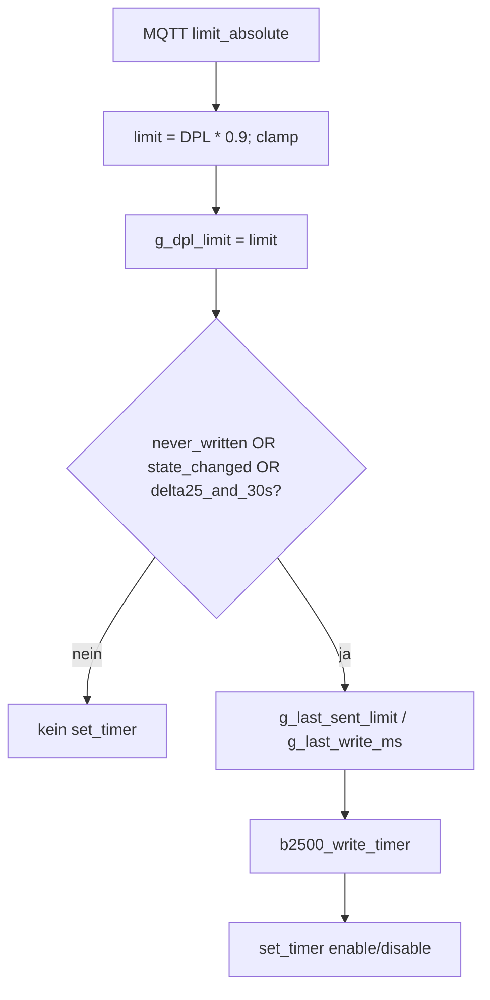

# B2500 DPL Flash-Schutz (Hysterese + Cooldown)

> **SSOT:** Diese Datei unter `MyPlans/` ist die verbindliche Planquelle für die Umsetzung.

## Ziel
OpenDTU bleibt Master. B2500 bleibt Follower mit unveränderter Kernlogik. Nur die Schreibfrequenz von `b2500.set_timer` (Flash) wird reduziert.

**Behalten:**
- Topic `solar/114184878827/status/limit_absolute`
- `limit = DPL * 0.9`
- unter 50 W → Timer aus / 0 W
- max 800 W
- BLE `on_connect`: Timer1 24/7 einmalig initialisieren

**Neu:**
- kein Write bei unverändertem Limit
- Ein/Aus (`0` ↔ `>0`) sofort
- sonst nur bei Δ ≥ 25 W **und** ≥ 30 s seit letztem Write
- Erstschreib-Ausnahme (`g_last_sent_limit < 0`), damit der erste Write nach Boot nicht am Cooldown scheitert

Langfristziel hm2mqtt bleibt außerhalb dieses Plans.

## Datei
Nur [config.yaml](d:\Projekte\ESPHome_B2500\config.yaml).

## Ablauf



## Konkrete Änderungen

### 1) Globals erweitern
Bestehendes `g_dpl_limit` behalten. Ergänzen:

- `g_last_sent_limit` (`int`, init `-1`, kein Restore)
- `g_last_write_ms` (`uint32_t`, init `0`, kein Restore)

### 2) MQTT `on_message` ersetzen
Aktuell (jeder Message → `set_timer`):

```107:128:d:\Projekte\ESPHome_B2500\config.yaml
        - lambda: |-
            int limit = (int) atof(x.c_str()) * 0.9 ;
            ...
            id(g_dpl_limit) = limit;
        - if:
            condition:
              lambda: 'return id(g_dpl_limit) < 50;'
            then:
              - b2500.set_timer: ...
```

Neu: Lambda berechnet Limit (`*0.9`, `<50 → 0`, max 800), setzt immer `g_dpl_limit`, und ruft nur bei Gate-Erfüllung das Script auf:

- `never_written = g_last_sent_limit < 0`
- `state_changed = (limit==0 && last>0) || (limit>0 && last<=0)`
- `diff = abs(limit - last)`
- Write wenn `never_written` **oder** (`limit != last` und (`state_changed` oder (`diff >= 25` und `millis()-last_write >= 30000`)))
- bei Write: `g_last_sent_limit` / `g_last_write_ms` setzen, `ESP_LOGI("dpl", "Write B2500 Timer 0: %d W", limit)`, dann `id(b2500_write_timer).execute()`

### 3) Script `b2500_write_timer`
Top-Level `script:` mit `mode: single`:

- wenn `g_last_sent_limit < 50` → `set_timer` Timer 0 `enabled: false`
- sonst → `enabled: true`, `output_power: g_last_sent_limit`

### 4) BLE `on_connect` unverändert lassen
Der einmalige Timer1-Init (00:00–23:59) in `ble_client.on_connect` bleibt; das ist selten und ok.

## Verifikation
- Kompilieren + OTA
- Log: `Write B2500 Timer 0` nur bei Ein/Aus oder spürbarer Änderung (≥25 W, ≥30 s), nicht bei jedem OpenDTU-Tick
- Nach Reboot: erster sinnvoller Limit-Write ohne 30-s-Verzögerung
