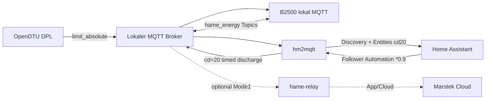

# hm2mqtt: lokales MQTT + Flash-frei (+ optional Cloud-Relay)

## Ist-Zustand (dein Setup)

- OpenDTU = Master (`limit_absolute`); ESP32/[config.yaml](d:\Projekte\ESPHome_B2500\config.yaml) = Follower via BLE `set_timer` (Flash), inzwischen mit Hysterese/Cooldown.
- HA **2026.11.2**, MQTT-Integration geladen (Broker laut HA `192.168.178.28`; in Secrets `george:1883`).
- B2500-Entities in HA kommen von **ESPHome**, nicht von hm2mqtt.
- BLE-MAC in Secrets: `60:32:3b:d1:29:79` → für hm2mqtt als `deviceId` ohne Doppelpunkte: `60323bd12979` (Bluetooth-MAC, **nicht** WLAN-MAC).

## Zielarchitektur



**Kernpunkt Flash:** hm2mqtt sendet Timed-Discharge standardmäßig als **`cd=20` (no-flash)**. Schalter „Use Flash Commands“ muss **aus** bleiben (sonst wieder `cd=07` → Flash).

ESPHome-BLE-`set_timer` für DPL dann **abschalten** (sonst weiter Flash + Doppelsteuerung).

## Entscheidende Repos / Docs

| Zweck | Link |
|-------|------|
| hm2mqtt (HA-Entities, Parsing, Steuerung) | https://github.com/tomquist/hm2mqtt |
| B2500-Protokoll / Flash vs. no-flash (`cd=07`/`cd=20`) | https://github.com/tomquist/hm2mqtt/blob/main/docs/b2500.md |
| hame-relay (Cloud ↔ lokaler Broker) | https://github.com/tomquist/hame-relay |
| hmjs (B2500 MQTT per BLE im Browser) | https://github.com/tomquist/hmjs — Tool: https://tomquist.github.io/hmjs/ |
| ESPHome-B2500 (aktuell, Flash-Warnung) | https://github.com/tomquist/esphome-b2500 — Docs: https://tomquist.github.io/esphome-b2500/ |
| OpenDTU-OnBattery (Master) | https://github.com/hoylabs/OpenDTU-OnBattery |
| Dieses Repo | https://github.com/sneumeister/ESPHome_B2500 |

## Teil A — Was für hm2mqtt + Flash-frei nötig ist

Voraussetzung: **ein** B2500 → Variant **A** (Gerät spricht direkt lokalen Broker). Proxy-Port `1890` erst bei mehreren Geräten / FW 226.5/108.7 nötig.

### A1. Lokales MQTT am B2500 aktivieren

1. Mit Chrome/Android + BLE: [hmjs](https://tomquist.github.io/hmjs/) **oder** Support/App „MQTT freischalten“.
2. Broker setzen: Host des lokalen Brokers (z. B. `george` / `192.168.178.28`), Port `1883`, User/Pass wie HA-MQTT (`pimqtt` …).
3. Notieren: **deviceType** (z. B. `HMA-…` / `HMJ-…`) + **Bluetooth-MAC**.
4. Firmware: no-flash Timed-Discharge braucht ausreichend neue FW (Doku: ab ~214.1 bzw. HMJ mit `cd=20`-Support, z. B. 116.x).

**Nebenwirkung:** Direkte Cloud-/App-Anbindung fällt weg, bis Teil B (hame-relay). BLE-App in Reichweite bleibt möglich.

### A2. hm2mqtt in HA installieren

1. HA App Store: Repo `https://github.com/tomquist/hm2mqtt` hinzufügen, App „hm2mqtt“ installieren.
2. MQTT auf denselben Broker wie HA zeigen (Default oft ok).
3. Device-Eintrag, z. B.:

```yaml
devices:
  - deviceType: "<aus_hmjs>"
    deviceId: "60323bd12979"
```

4. Starten → MQTT Discovery → neue hm2mqtt-Entities (Time Period / Output Power).
5. Entity **Use Flash Commands** = **off** (Default; retained — prüfen).

### A3. DPL-Follower von ESPHome auf HA/hm2mqtt umziehen

1. Neue HA-Automation (OpenDTU bleibt Master):
   - Trigger: MQTT `solar/114184878827/status/limit_absolute` **oder** vorhandene OpenDTU-Entity.
   - Logik wie jetzt: `limit = DPL * 0.9`, &lt;50 → aus/0, max 800; Hysterese 25 W + 30 s Cooldown sinnvoll beibehalten.
   - Aktion: hm2mqtt-Number für Time-Period-1-Output setzen (bzw. Period enable 00:00–23:59 einmalig).
2. In [config.yaml](d:\Projekte\ESPHome_B2500\config.yaml): MQTT-`on_message` → `b2500_write_timer` / `set_timer` **entfernen oder disable** (Flash-Pfad tot).
3. ESPHome vorerst für Sensorik/BLE-Fallback behalten oder später ausdünnen (Doppel-Entities in HA vermeiden).

### A4. Verifikation Flash-frei

- hm2mqtt-Logs / MQTT: Befehle mit **`cd=20`**, nicht `cd=07`.
- Nach Reboot des B2500: volatile Limits ggf. weg → Automation/Init muss Period + Limit erneut setzen.
- OpenDTU und B2500-Ausgang laufen weiter parallel (*0.9), ohne Timer-Flash-Spam.

## Teil B — Zusätzlich für Marstek-Cloud / App (hame-relay)

Nur nötig, wenn die **offizielle App remote** (außerhalb BLE) weiter funktionieren soll.

### B1. Rolle

- **hame-relay** = reiner MQTT-Bridge (Cloud ↔ lokal). **Keine** HA-Entities.
- Bei Variant A (B2500 → lokal): **Mode 1** — lokaler Telemetrie-/Statusverkehr zur Cloud spiegeln, App-Commands zurück auf den lokalen Broker.

### B2. Schritte

1. HA App Store: Repo `https://github.com/tomquist/hame-relay`, App installieren.
2. Config: Hame-Account `username` / `password` (Marstek/Hame-Login).
3. `mqtt_uri` auf denselben lokalen Broker wie hm2mqtt/HA.
4. Für B2500 nach lokalem MQTT: Mode-1-/Forwarding laut App-Auto-Config (kein `inverse_forwarding` experimentell umbiegeln).
5. Start → Logs: Device-Liste / Forwarding-Richtung prüfen; App remote testen (Status + Befehl).
6. hm2mqtt bleibt parallel für HA-Steuerung; Cloud-Befehle und lokale Automation können konkurrieren — klare Priorität (lokal DPL-Follower) beibehalten.

### B3. Alternative ohne lokales MQTT am Gerät

Variant **B**: Gerät bleibt Cloud-MQTT → hame-relay holt Traffic lokal → hm2mqtt. Für **dein** Ziel (Flash-frei + OpenDTU-Follower) ist Variant **A** die bessere Primärstrecke; B nur Fallback, falls lokales MQTT am Gerät scheitert.

## Abgrenzung / Nicht-Ziele dieses Plans

- Kein Ersatz von OpenDTU-DPL durch Adaptive/SmartMeter am B2500.
- Kein ESPHome-BLE-`set_timer`-Dauerbetrieb parallel zu hm2mqtt.
- Kein Push/PR in diesem Plan (nur Doku + spätere Umsetzungs-Todos).

## Empfohlene Umsetzungsreihenfolge

1. hmjs: Gerätetyp + lokales MQTT setzen; Cloud-Ausfall bewusst akzeptieren.
2. hm2mqtt HA-App + Device; Use Flash Commands off; `cd=20` verifizieren.
3. HA-Automation DPL→hm2mqtt; ESPHome-Timer-Writes entfernen.
4. Optional: hame-relay Mode 1 für App/Cloud.
5. README im Repo um Architektur-Hinweis ergänzen.
